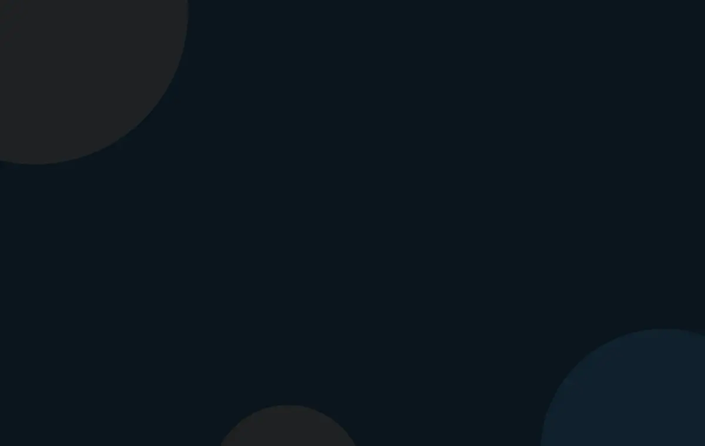
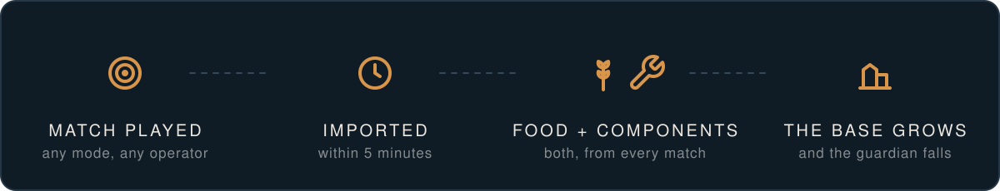
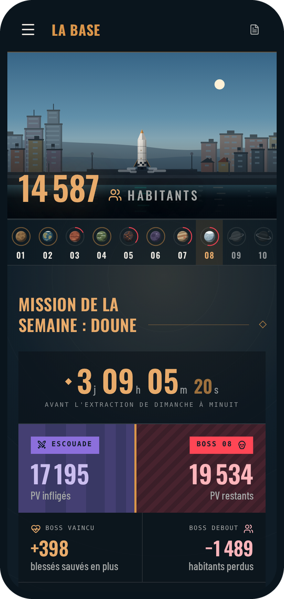
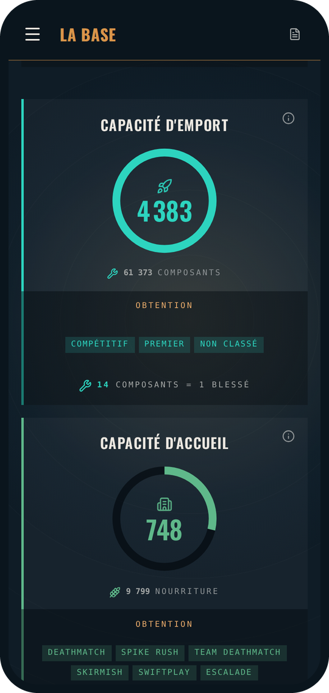
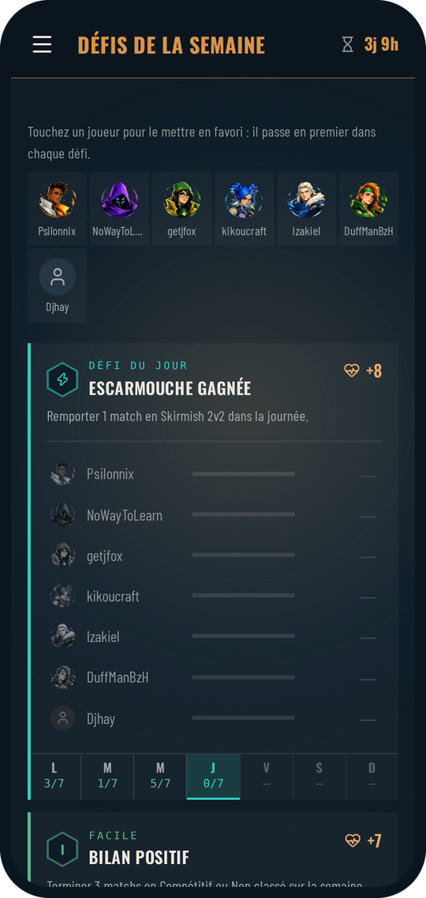
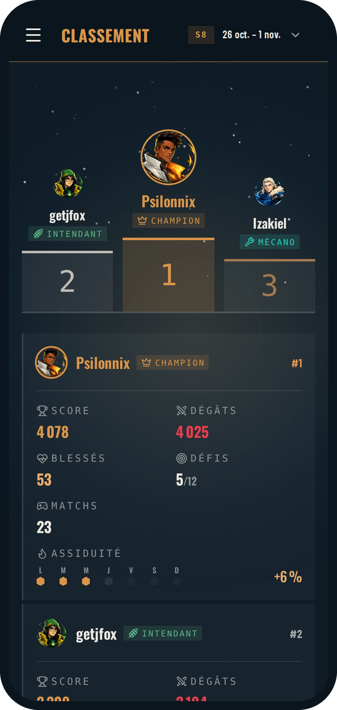
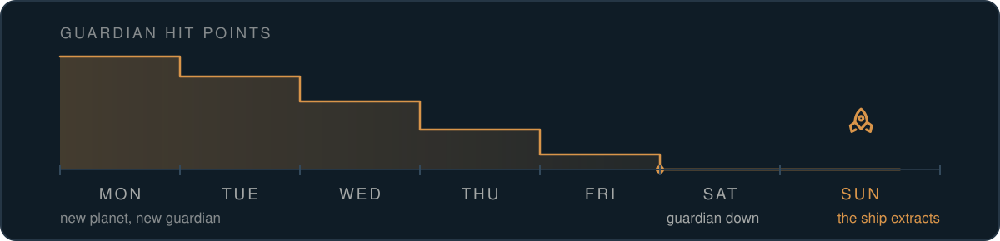

<p align="center">
  
</p>

<h1 align="center">ValoQuests</h1>

<p align="center">
  <b>Your matches no longer end at the scoreboard.</b><br>
  Ten weeks, ten planets, one base that only grows when the squad plays.<br>
  Every Valorant match is imported on its own and turned into a cooperative rescue campaign.
</p>

<p align="center">
  
  
  
  
</p>

<p align="center">
  
  <br>
  <sub>A 45-second tour. A real squad, mid-campaign.</sub>
</p>

## Every match already meant something to you. Now it means something to everyone.

Your squad plays what it always plays. ValoQuests reads every match minutes after the lobby closes and
turns it into a rescue campaign the whole roster shares. Nothing to declare. Nothing to screenshot.
Nothing to chase on a Sunday night.

<p align="center">
  
</p>

---

## A peek inside

<p align="center">
  
  
  
  
  <br>
  <sub><b>The&nbsp;base</b> · <b>The&nbsp;stocks</b> · <b>Challenges</b> · <b>Leaderboard</b></sub>
</p>

---

##  Two resources. Both from every match.

Competitive mostly brings back **components**, the gear it takes to reach the wounded. Deathmatch
mostly brings back **food**, what feeds the base tonight and settles the rescued on Sunday.

These are real stocks. Nothing is wiped on Monday. What you do not spend, you keep for the week that
will need it.

| A match          | Value |  Food |  Components |
| ---------------- | ----- | ------------------------------------------------------------ | ------------------------------------------------------------------------ |
| Competitive win  | 500   | 150                                                          | 350                                                                      |
| Competitive loss | 350   | 105                                                          | 245                                                                      |
| Deathmatch win   | 150   | 105                                                          | 45                                                                       |
| Deathmatch loss  | 100   | 70                                                           | 30                                                                       |

---

##  Seven days. One guardian. One Sunday.

Monday, a new planet. A guardian holds the ground between the ship and the wounded left on it. Every
match, by every operator, takes hit points off it. Its bar falls while you play.

<p align="center">
  
</p>

- **It can fall on Tuesday afternoon.** The week keeps paying until Sunday either way.
- **Challenges deal it no damage.** They bring wounded home whatever happens, spending nothing. A
  bonus, never a toll.
- **Push it to 93% and the base loses 0.2%.** Falling short is survivable. Doing nothing is not.

---

##  Every mode counts. Even the ten minute one.

| Mode                                              |  Food |  Components |
| ------------------------------------------------- | ------------------------------------------------------------ | ------------------------------------------------------------------------ |
| Competitive, Premier, Unrated                     | 30%                                                          | **70%**                                                                  |
| Deathmatch, Team Deathmatch, Spike Rush, Skirmish | **70%**                                                      | 30%                                                                      |

Ranked pays more per match. It also takes 35 minutes. Every value is tuned so that an hour of play is
worth about the same wherever you spend it, which means nobody in the squad is ever told what to queue.

---

##  Showing up beats grinding.

| Match of the day | 1 to 5 | 6 to 9 | 10 and beyond |
| ---------------- | ------ | ------ | ------------- |
| Worth            | 100%   | 50%    | 25%           |

| Days in a row | 1   | 2   | 3   | 4   | 5   | 6+       |
| ------------- | --- | --- | --- | --- | --- | -------- |
| Bonus         | 0%  | +2% | +4% | +6% | +8% | **+10%** |

The sixth match of the night is worth half. The tenth, a quarter. And the streak bonus stops at 10% on
purpose: miss a day, and first place is still within reach.

---

##  One dial, picked at launch.

You pick the difficulty when you open a campaign, and it is frozen for the ten weeks. It carries the
**reference** everything else is a multiple of: guardians, groups of wounded, challenge rewards, all
of it, per active player. Two operators or twenty, the campaign plays the same.

| Difficulty | Weekly reference per player | What it asks for                                   |
| ---------- | --------------------------- | -------------------------------------------------- |
| Amateur    | 5,300                       | A squad that plays regularly                       |
| Pro        | 10,600                      | Twice the guardian, and the harder written targets |

The difficulty also decides which of a challenge's two hand-written targets you play against, so a
Pro squad chases harder objectives against a bigger guardian for the same relative reward.

---

##  Four titles. Every week. Rarely the same player.

| Title                                                                      | Goes to                           |
| -------------------------------------------------------------------------- | --------------------------------- |
|  **Mechanic** | The most components over the week |
|  **Quartermaster**  | The most food                     |
|  **Regular**      | The longest streak of days played |
|  **Scout**        | The most challenges validated     |

The weekly leaderboard counts guardian damage and wounded brought home, and resets every Monday.
Nobody is ever out of the campaign because of one bad week.

---

## For the squad. And for the club.

|  Players |  Clubs and coaches |
| ---------------------------------------------------------------- | ------------------------------------------------------------------------- |
| A goal that survives a losing streak                             | Who is actually playing, week by week                                     |
| A leaderboard that starts over every Monday                      | One objective the whole roster shares for ten weeks                       |
| Titles, streaks, profiles, match by match detail                 | Dashboards a non player reads in thirty seconds                           |
| Solo queue still counts toward the team goal                     | A closed campaign, archived, its score frozen                             |

---

## Get it

You bring the squad and a free [HenrikDev](https://docs.henrikdev.xyz) key, ValoQuests brings the rest.

**Try it** in one command, nothing to configure:

```bash
docker compose up --build    # or: make up
```

Then open http://localhost:8000. The squad starts empty: open `/admin/login`, sign in with
`valoquests-demo-admin-key-0123456789`, add the players by Riot ID and launch a campaign. Matches are
imported once `backend/.env` holds a real `HENRIK_API_KEY`.

**Host it** for your squad: two Docker images (web and API, amd64) and a PostgreSQL database. Your
server writes its own compose from the contract in [docs/deployment.md](docs/deployment.md).

**Hack on it**: `make setup && make dev`, then [CONTRIBUTING.md](CONTRIBUTING.md).

The interface speaks French and English.

## Under the hood

<details>
<summary>Stack, quality and supply chain</summary>
<br>

- **Frontend**: Angular 22 (standalone, zoneless, signals, `httpResource`), Tailwind 4 for layout and SCSS on the "Expédition" tokens for the rest, `chart.js` for the profiles, self-hosted Oswald and Barlow Condensed, served by nginx as the single entry point.
- **Backend**: Spring Boot 4 on Java 25, PostgreSQL 17 with Flyway. The campaign is never incremented: it is replayed from day one out of its matches and challenges by a pure engine, so every job can run in any order, any number of times.
- **Import**: a HenrikDev client behind one rate limiter and a retry budget, walking each season with checkpoints, every five minutes.
- **Auth**: everything players see is public and read-only; the backoffice takes one key, with a per-address lockout.
- **Quality**: a comment on every declaration, ESLint, Stylelint, Prettier, Checkstyle, Spotless, SpotBugs, ArchUnit layering, JUnit on Testcontainers with JaCoCo floors, Vitest with coverage floors, and Playwright smoke tests with axe-core against the images.
- **Supply chain**: every push to `main` is tested, scanned with Grype and driven in a browser before its images are published on GHCR; Dependabot and CodeQL watch the rest.

[](https://github.com/ThomasHtn/valoquests/actions/workflows/deliver.yml)
[](https://github.com/ThomasHtn/valoquests/actions/workflows/codeql.yml)

</details>

- [CONTRIBUTING.md](CONTRIBUTING.md): setup, code map, conventions. Start here.
- [docs/GAMEPLAY.md](docs/GAMEPLAY.md) (in French): every rule and constant of the campaign.
- [docs/CHALLENGES.md](docs/CHALLENGES.md) and [the catalogue](docs/CHALLENGES-CATALOGUE.md) (in French): how challenges are written and drawn.
- [docs/DESIGN.md](docs/DESIGN.md) (in French): the visual direction and its constraints.
- [docs/deployment.md](docs/deployment.md): images, routing, variables.
- [backend/README.md](backend/README.md) and [frontend/README.md](frontend/README.md): the code map of each side.
- [tools/tour/README.md](tools/tour/README.md): how the tour and the screens above are recorded.

## Credits

- Match data from the [HenrikDev Valorant API](https://docs.henrikdev.xyz).
- **Oswald** and **Barlow Condensed** typefaces, under the [SIL Open Font License 1.1](https://openfontlicense.org).
- **Lucide** icons, under the [ISC licence](https://lucide.dev/license), in the app and above.
- ValoQuests was created under Riot Games' "Legal Jibber Jabber" policy using assets owned by Riot Games.
  Riot Games does not endorse or sponsor this project.
